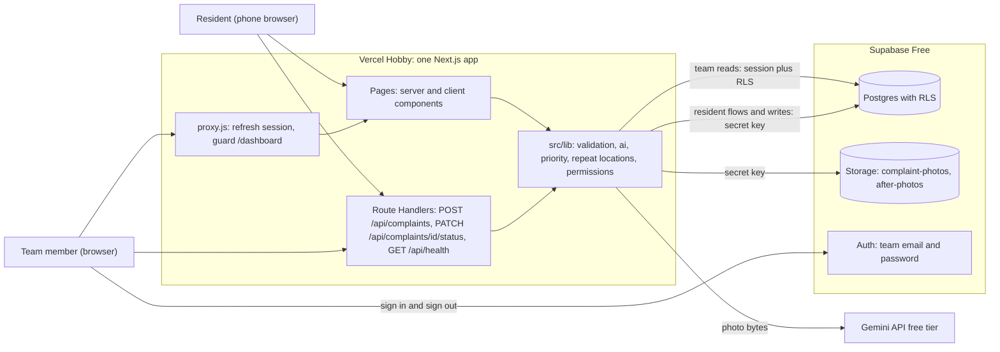
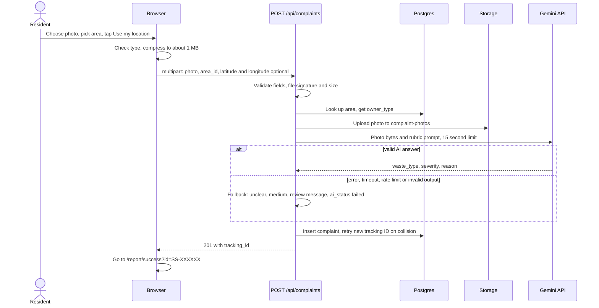
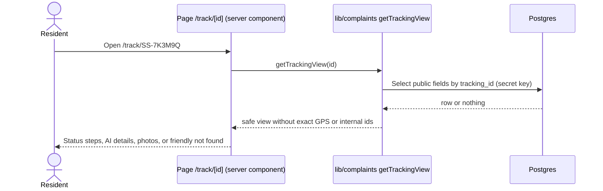
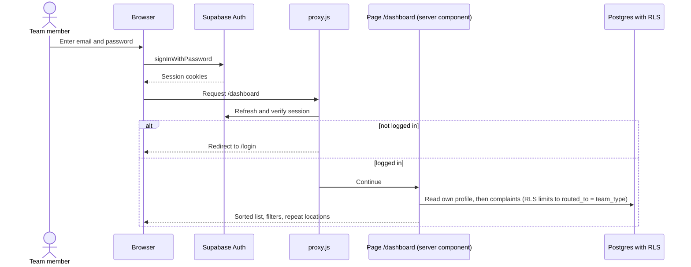
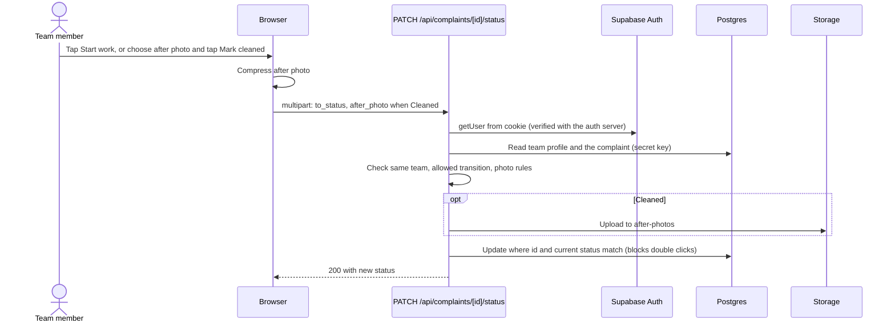
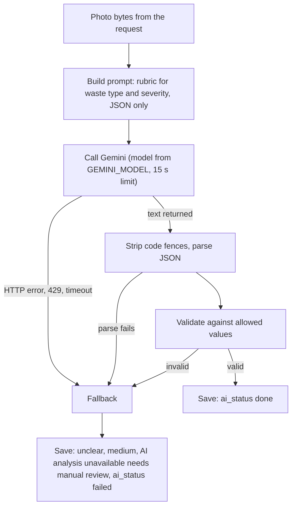
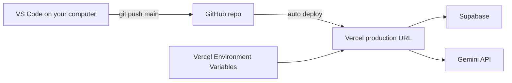

# SafaiSetu Architecture

Version 1.0 design, Day 2 (3 November 2026). Source of truth: `SafaiSetu_PRD.docx` and `SafaiSetu_Implementation_Blueprint.docx`. Items marked **(pending approval)** change the Blueprint and are listed in section 12.

---

## 1. Goals of this architecture

- Deliver every PRD requirement (FR-1 to FR-19) with the fewest moving parts.
- Use free tools only.
- Keep secret keys on the server. Residents never need an account.
- Make Days 3 to 10 pure implementation: every decision below is already made.

---

## 2. Final tech stack

| Layer | Choice | Why it is the best fit | Cost |
|---|---|---|---|
| Frontend | **Next.js 16 (App Router), React, JavaScript, Tailwind CSS** | One codebase for pages and API. Server components let pages read data without extra endpoints. Tailwind gives fast mobile-first styling. JavaScript (not TypeScript) keeps the learning load low for a 10-day build. | Free |
| Backend | **Next.js Route Handlers (Node.js runtime)** | No separate server to build or deploy. Only 3 endpoints are needed (see API.md). | Free |
| Database | **Supabase Postgres** | Real relational database with constraints and Row Level Security, which this data model needs. Web dashboard for SQL and tables. | Free plan |
| File storage | **Supabase Storage** (public buckets `complaint-photos`, `after-photos`) | Same project as the database; gives public image URLs. | Free plan |
| Authentication | **Supabase Auth, email + password, team members only** | Built in, secure sessions via cookies, no sign-up screen needed. Residents have no accounts (PRD). | Free plan |
| AI | **Gemini API, free tier, Flash-class vision model** (name stored in env var `GEMINI_MODEL`) | Accepts images, returns structured JSON, free tier needs no card. The model name is configurable because Google changes model names and free-tier limits. | Free tier |
| Hosting | **Vercel Hobby** | Zero-config for Next.js, HTTPS (needed for GPS), auto-deploy from GitHub. | Free |
| Source control | **Git + GitHub** | Required deliverable; triggers deployments. | Free |

### Libraries (kept to the minimum)

| Library | Used for | Day |
|---|---|---|
| `@supabase/supabase-js`, `@supabase/ssr` | Database, storage, auth clients with cookie sessions | 2-3 |
| `server-only` | Makes the build fail if the admin (secret key) client is imported into browser code | 2 |
| `browser-image-compression` | Shrinks phone photos before upload | 4 |
| `@google/genai` | Calling the Gemini API from the server | 5 |

No UI kit, no form library, no validation library, no ORM. Validation is a small hand-written module.

### Verified on 3 November 2026 (web check, re-verify if a step fails)

- **Next.js 16:** `middleware.js` was renamed to `proxy.js`; the old name still works but is deprecated. Requires Node.js 20.9 or newer. `params` in pages and route handlers are asynchronous (must be awaited).
- **Supabase keys:** new projects use a **publishable key** (`sb_publishable_...`, replaces `anon`) and a **secret key** (`sb_secret_...`, replaces `service_role`). The Blueprint names `anon` and `service_role`; this document uses the new names.
- **Vercel Functions:** request body is capped at **4.5 MB**, so photos must be compressed before upload (the plan already does this). Function duration is set explicitly per route.
- **Gemini free tier:** per-model limits are shown only in Google AI Studio. Free-tier inputs may be used by Google to improve its products, so the app shows a short photo notice (section 9).

### Environment variables

| Name | Where | Secret? |
|---|---|---|
| `NEXT_PUBLIC_SUPABASE_URL` | browser + server | No |
| `NEXT_PUBLIC_SUPABASE_PUBLISHABLE_KEY` | browser + server | No (low privilege, protected by RLS) |
| `SUPABASE_SECRET_KEY` | server only | **Yes** |
| `GEMINI_API_KEY` | server only | **Yes** |
| `GEMINI_MODEL` | server only | No |

---

## 3. Component diagram

### Which Supabase client is used where

| Client file | Key | Runs in | Used for |
|---|---|---|---|
| `lib/supabase/client.js` | publishable | Browser | Login and logout only |
| `lib/supabase/server.js` | publishable + user cookie session | Server (pages, handlers) | Team reads under RLS; verifying who is logged in |
| `lib/supabase/admin.js` | **secret** | Server only (`server-only` guard) | Resident submit, public tracking view, status updates, storage uploads |

---

## 4. Data flows

### 4.1 Resident reports garbage (FR-1 to FR-8)

### 4.2 Resident tracks a complaint (FR-9)

### 4.3 Team logs in and views the dashboard (FR-10 to FR-13, FR-16)

### 4.4 Team updates status and uploads an after photo (FR-14, FR-15)

---

## 5. Request lifecycle (applies to every request)

1. Browser sends the request to Vercel over HTTPS.
2. `proxy.js` runs only for `/dashboard/*` and `/login`. It refreshes the session cookie and redirects logged-out users to `/login`. It is a convenience guard, not the security boundary.
3. The page or route handler runs on the Node.js runtime.
4. Handlers and pages call functions in `src/lib`. They never talk to Supabase directly.
5. **Authorization is re-checked on the server every time** (team identity from the verified session, never from the request body).
6. The response is HTML (pages) or JSON (handlers) using the error format in API.md.

| Limit | Value | Reason |
|---|---|---|
| Photo after browser compression | about 1 MB target, 3 MB server maximum | Vercel's 4.5 MB request cap and faster uploads |
| AI call timeout | 15 seconds | Keeps the request responsive |
| `maxDuration` on submit route | 30 seconds | Covers upload + AI + insert with headroom |
| Tracking ID retries | up to 5 | Handles the rare collision |

---

## 6. AI interaction

Rules:

- **Input to the AI:** the photo only. No GPS, area name or user data is sent.
- **Output contract:** exactly three fields: `waste_type` (`wet_food`, `plastic`, `construction_debris`, `mixed`, `unclear`), `severity` (`low`, `medium`, `high`), `reason` (one sentence, trimmed to 160 characters).
- **Rubric text** lives in `src/lib/ai/prompt.js` and mirrors PRD section 9.1.
- **Advisory only:** team members see the photo and decide. The AI never blocks a complaint (FR-6).
- **No retries** on 429 or timeouts. Fall back immediately, keep the request fast.
- **Never log** photos or keys.

---

## 7. External services

| Service | Purpose | Plan | What to watch | If it fails |
|---|---|---|---|---|
| Supabase | Database, storage, auth | Free | Project may pause after inactivity (check dashboard before demos); storage size | App cannot save or read; fix by resuming the project |
| Gemini API | Photo analysis | Free tier | Rate limits and model names are shown only in AI Studio; inputs may be used by Google | Fallback result, complaint still saved |
| Vercel | Hosting and HTTPS | Hobby (non-commercial use) | 4.5 MB request cap; function limits | Redeploy; check logs |
| GitHub | Source and deploy trigger | Free | None | n/a |

---

## 8. Deployment

- One environment in production (no staging). `.env.local` holds local secrets; Vercel holds production secrets; `.env.example` documents names only.
- Work on `main` with small commits. Every push redeploys.

---

## 9. Security and privacy summary

- Secret keys exist only in `.env.local` and Vercel, never in `NEXT_PUBLIC_` variables, never in Git, never in chats or screenshots.
- `server-only` import guard on the admin client.
- RLS is enabled on every table. Teams can only **read** their own complaints. **There is no UPDATE policy**: all writes go through server routes that check permissions (pending approval, see 12).
- Public tracking never returns exact GPS or internal ids.
- Uploads: type checked by file signature, size capped, random file names, bucket limits set in Supabase.
- Known v1 limits, accepted: no CAPTCHA or rate limiting on public submissions; photo URLs are public to anyone with the link; photos shown on the report form must carry a notice: "Photos are analysed by an AI service. Please avoid faces and number plates."

---

## 10. Failure handling (summary)

| Failure | Behaviour |
|---|---|
| GPS denied or unavailable | Submit allowed with area only; stored with null coordinates |
| AI fails | Fallback values, `ai_status = failed`, complaint saved |
| Photo upload fails | Request fails with a clear message; nothing saved |
| Insert fails after upload | Best-effort delete of the uploaded photo, return error |
| Tracking ID collision | New ID, up to 5 tries |
| Double tap on status buttons | Optimistic update returns 409; button disabled in UI |
| Session expired | Redirect to `/login` |

---

## 11. Architecture decision log

| # | Decision | Reason |
|---|---|---|
| A1 | One Next.js app for UI and API | Least to build, one deploy |
| A2 | Resident writes only through a server route using the secret key | No public insert rules; validation in one place |
| A3 | Team reads use RLS; team writes go through the server | Stops a logged-in user editing severity or team directly with the browser key |
| A4 | AI call is synchronous inside the submit request | Simple; success page can show the result immediately |
| A5 | JavaScript, not TypeScript | Lower learning load for 10 days |
| A6 | Pages read data through `src/lib` functions, no custom GET API | Fewer endpoints; identical security |
| A7 | Model name in `GEMINI_MODEL` | Survives model renames without code changes |
| A8 | Public buckets with unguessable file names | Simplest way to show photos; accepted risk |

---

## 12. Changes from Blueprint v1.0 (pending approval)

| # | Change | Reason |
|---|---|---|
| C1 | Remove the `team updates own complaints` RLS policy; all updates via PATCH route | Policy would let a logged-in user change any column (severity, team) from the browser |
| C2 | Drop `GET /api/track/[id]`; tracking page uses a lib function | One less endpoint; same data and security |
| C3 | `src/middleware.js` becomes `src/proxy.js`; env names `NEXT_PUBLIC_SUPABASE_PUBLISHABLE_KEY` and `SUPABASE_SECRET_KEY`; add `GEMINI_MODEL`, `server-only`, `maxDuration` | Next.js 16 and new Supabase projects (verified above) |
| C4 | Move "Top repeat locations" panel from Day 7 to Day 8 | Needs demo data to verify; lightens Day 7 |
| C5 | Account, scaffold and first-deploy tasks move to the start of Day 3 if not finished today | Today is a design day; see PROJECT-STRUCTURE.md for the Day 3 start conditions |
