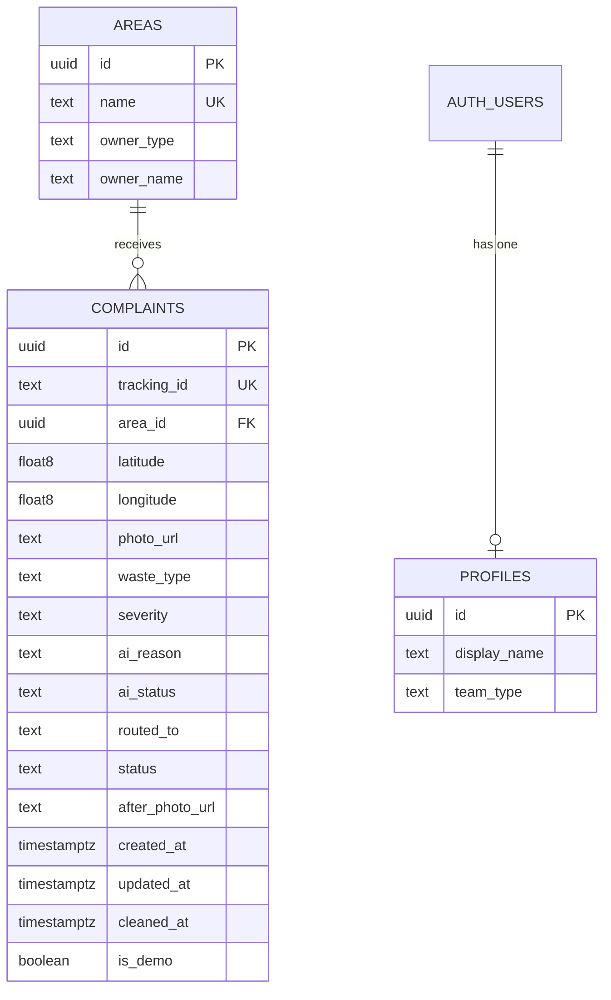

# SafaiSetu Database Schema

Version 1.0 design, Day 2 (3 November 2026). Database: Supabase Postgres. This replaces Appendix A of the Blueprint **once approved** (changes: extra constraints, indexes, `updated_at` trigger, and no UPDATE policy).

---

## 1. Entity relationship diagram



`AUTH_USERS` is Supabase's built-in `auth.users` table (created by Supabase Auth, not by us). `profiles.id` is the same value as the user's id.

---

## 2. Tables and fields

### 2.1 `areas`

| Column | Type | Null | Default | Rules | Purpose |
|---|---|---|---|---|---|
| id | uuid | no | `gen_random_uuid()` | PK | Identifier |
| name | text | no | | unique | Shown in the dropdown |
| owner_type | text | no | | `colony` or `municipal` | Drives routing |
| owner_name | text | no | | | Shown to residents ("Sent to ...") |

### 2.2 `profiles` (team members)

| Column | Type | Null | Default | Rules | Purpose |
|---|---|---|---|---|---|
| id | uuid | no | | PK, FK to `auth.users(id)`, delete cascades | Links login to team |
| display_name | text | no | | | Shown in the dashboard header |
| team_type | text | no | | `colony` or `municipal` | Which complaints this user may see |

### 2.3 `complaints`

| Column | Type | Null | Default | Rules | Purpose |
|---|---|---|---|---|---|
| id | uuid | no | `gen_random_uuid()` | PK | Internal id (team URLs) |
| tracking_id | text | no | | unique, format `SS-` + 6 chars | Public id for residents |
| area_id | uuid | no | | FK to `areas(id)` | Chosen area |
| latitude | float8 | yes | | -90 to 90; both-or-neither with longitude | GPS (null if denied) |
| longitude | float8 | yes | | -180 to 180 | GPS |
| photo_url | text | no | | | Public URL of the report photo |
| waste_type | text | yes | | allowed list | AI result |
| severity | text | yes | | `low`, `medium`, `high` | AI result |
| ai_reason | text | yes | | | One-line reason |
| ai_status | text | no | `pending` | `pending`, `done`, `failed` | See note below |
| routed_to | text | no | | `colony` or `municipal` | Snapshot of the area's owner type at report time |
| status | text | no | `Reported` | `Reported`, `In Progress`, `Cleaned` | Workflow state |
| after_photo_url | text | yes | | required when Cleaned | Proof of cleanup |
| created_at | timestamptz | no | `now()` | | Age and sorting |
| updated_at | timestamptz | no | `now()` | set by trigger | Last change |
| cleaned_at | timestamptz | yes | | required when Cleaned | Cleanup time |
| is_demo | boolean | no | `false` | | Marks seeded demo rows |

Notes:

- `ai_status = pending` only exists on **Day 4**, before the AI step is built. From Day 5 the row is inserted after analysis, so it is `done` or `failed`.
- `routed_to` is deliberately stored (not derived by join) so Row Level Security stays simple and old complaints keep their original team if an area's owner changes later.

### 2.4 Enumerations and display labels

| Field | Stored value | Shown as |
|---|---|---|
| waste_type | `wet_food` | Wet / food waste |
| | `plastic` | Plastic |
| | `construction_debris` | Construction debris |
| | `mixed` | Mixed |
| | `unclear` | Unclear |
| severity | `low` / `medium` / `high` | Low / Medium / High |
| status | `Reported` / `In Progress` / `Cleaned` | same |
| owner_type, routed_to, team_type | `colony` / `municipal` | Colony committee / Municipal team |

---

## 3. SQL to run on Day 3 (SQL Editor)

Run in order. Copy the final text into `supabase/schema.sql` in the repo.

### 3.1 Tables

```sql
create table areas (
  id uuid primary key default gen_random_uuid(),
  name text not null unique,
  owner_type text not null check (owner_type in ('colony','municipal')),
  owner_name text not null
);

create table profiles (
  id uuid primary key references auth.users(id) on delete cascade,
  display_name text not null,
  team_type text not null check (team_type in ('colony','municipal'))
);

create table complaints (
  id uuid primary key default gen_random_uuid(),
  tracking_id text not null unique,
  area_id uuid not null references areas(id),
  latitude double precision,
  longitude double precision,
  photo_url text not null,
  waste_type text,
  severity text,
  ai_reason text,
  ai_status text not null default 'pending',
  routed_to text not null,
  status text not null default 'Reported',
  after_photo_url text,
  created_at timestamptz not null default now(),
  updated_at timestamptz not null default now(),
  cleaned_at timestamptz,
  is_demo boolean not null default false,

  constraint complaints_tracking_format
    check (tracking_id ~ '^SS-[A-HJKMNP-Z2-9]{6}$'),
  constraint complaints_waste_type_valid
    check (waste_type in ('wet_food','plastic','construction_debris','mixed','unclear')),
  constraint complaints_severity_valid
    check (severity in ('low','medium','high')),
  constraint complaints_ai_status_valid
    check (ai_status in ('pending','done','failed')),
  constraint complaints_routed_to_valid
    check (routed_to in ('colony','municipal')),
  constraint complaints_status_valid
    check (status in ('Reported','In Progress','Cleaned')),
  constraint complaints_gps_pair
    check ((latitude is null) = (longitude is null)),
  constraint complaints_lat_range
    check (latitude between -90 and 90),
  constraint complaints_lng_range
    check (longitude between -180 and 180),
  constraint complaints_ai_done_complete
    check (ai_status <> 'done'
           or (waste_type is not null and severity is not null and ai_reason is not null)),
  constraint complaints_cleaned_needs_proof
    check (status <> 'Cleaned'
           or (after_photo_url is not null and cleaned_at is not null))
);
```

### 3.2 Indexes and `updated_at` trigger

```sql
create index complaints_team_status_idx on complaints (routed_to, status);
create index complaints_area_idx on complaints (area_id);
create index complaints_created_idx on complaints (created_at desc);

create or replace function set_updated_at()
returns trigger
language plpgsql
set search_path = ''
as $$
begin
  new.updated_at = now();
  return new;
end;
$$;

create trigger complaints_set_updated_at
before update on complaints
for each row execute function set_updated_at();
```

### 3.3 Row Level Security (read-only for teams)

```sql
alter table areas enable row level security;
alter table profiles enable row level security;
alter table complaints enable row level security;

create policy areas_public_read on areas
  for select to anon, authenticated
  using (true);

create policy profiles_read_own on profiles
  for select to authenticated
  using (id = (select auth.uid()));

create policy complaints_team_read on complaints
  for select to authenticated
  using (routed_to = (select team_type from profiles where id = (select auth.uid())));

-- Intentionally NO insert or update policies on complaints.
-- Residents and status changes go through server routes using the secret key.
```

### 3.4 Demo areas

```sql
insert into areas (name, owner_type, owner_name) values
  ('Green Valley Colony',   'colony',    'Green Valley Colony Committee'),
  ('Sunrise Enclave',       'colony',    'Sunrise Enclave Committee'),
  ('Lakeview Apartments',   'colony',    'Lakeview Residents Committee'),
  ('Ward 7 - Old Town',     'municipal', 'Municipal Sanitation Team'),
  ('Ward 12 - Market Road', 'municipal', 'Municipal Sanitation Team');
```

### 3.5 Team profiles (after creating the two users in Authentication)

```sql
-- Replace with the real user ids from Authentication > Users
insert into profiles (id, display_name, team_type) values
  ('PASTE-COLONY-USER-ID',    'Colony Committee', 'colony'),
  ('PASTE-MUNICIPAL-USER-ID', 'Municipal Team',   'municipal');
```

---

## 4. Storage

| Bucket | Public | Written by | Folder convention |
|---|---|---|---|
| `complaint-photos` | yes | server (secret key) | `reports/<random-uuid>.<ext>`, `demo/<name>.<ext>` |
| `after-photos` | yes | server (secret key) | `after/<random-uuid>.<ext>`, `demo/<name>.<ext>` |

- No storage policies are needed because only the server writes.
- On each bucket, set **file size limit** to 5 MB and **allowed MIME types** to `image/jpeg, image/png, image/webp` (Storage, bucket, Edit bucket). The exact wording of these options can differ in the dashboard; send a screenshot on Day 3 if you cannot find them.
- File names are random so URLs cannot be guessed, but anyone holding a URL can view the photo (accepted v1 risk).

---

## 5. Who can do what

| Actor | Key and role | Areas | Complaints | Profiles | Storage |
|---|---|---|---|---|---|
| Resident (no login) | none; uses server routes | read (via server page) | create via POST route; read own by tracking ID via server page | none | upload via route |
| Team member | publishable key + session (`authenticated`) | read | **read only own team** (RLS); change status only via PATCH route | read own row | upload after photo via route |
| Server code | secret key (`service_role`, bypasses RLS) | all | all | all | all |

---

## 6. Query patterns (so Day 6-8 code is obvious)

| Need | Where | How |
|---|---|---|
| Areas dropdown | server page, `lib/areas.js` | select id, name, owner_type order by name |
| Tracking view | `lib/complaints.js getTrackingView` | secret key; select by `tracking_id`; join area name and owner_name; **return only**: tracking_id, status, area name, owner_name, waste_type, severity, ai_reason, ai_status, photo_url, after_photo_url, created_at, updated_at, cleaned_at. **Never return** latitude, longitude, id or routed_to internals. |
| Team list | server page, session client | select complaints with area name; RLS filters by team; sort in code with `lib/priority.js` |
| Detail | server page, session client | select one by `id` (RLS blocks other teams) |
| Repeat locations | `lib/repeatLocations.js` | from the team's rows with GPS: key = `area_id` + `round(lat, 3)` + `round(lng, 3)`; keep groups with 2 or more; sort by count; top 5. Three decimals is roughly 100 m. |
| Priority sort | `lib/priority.js` | open before Cleaned, then severity high > medium > low, then oldest first |

---

## 7. Validation against the PRD user stories

| Story | Needs | Provided by | Result |
|---|---|---|---|
| US-1 Upload photo, pick area | photo, area list | `complaints.photo_url`, `area_id`; `areas` table | Covered |
| US-2 GPS captured | coordinates, optional | `latitude`, `longitude` nullable, range and pair checks | Covered (also FR-3 no-GPS path) |
| US-3 Tracking ID | unique public id | `tracking_id` unique + format check | Covered |
| US-4 Tracking page details | status, AI fields, after photo | `status`, `waste_type`, `severity`, `ai_reason`, `after_photo_url`; safe view in section 6 | Covered |
| US-5 Team sees only its complaints | team identity and routing | `profiles.team_type`, `complaints.routed_to`, `complaints_team_read` | Covered |
| US-6 Priority sort and filter | severity, status, age | columns + `complaints_team_status_idx`, `created_at` | Covered |
| US-7 Move through statuses | status values, ordering | CHECK on values; **order enforced in PATCH route** with optimistic update | Covered (see gap 1) |
| US-8 After photo on cleanup | proof stored | `after_photo_url`, `cleaned_at`, `complaints_cleaned_needs_proof` | Covered |
| US-9 Top repeat locations | coordinates, area | `latitude`, `longitude`, `area_id`; grouping in code | Covered |

Requirement spot checks: FR-6 (AI fallback) fits `ai_status = failed`; FR-7 routing fits `routed_to`; FR-11 fits RLS; FR-15 fits `complaints_cleaned_needs_proof`; FR-17 fits `is_demo`.

### Gaps found and decisions

1. **Status order cannot be a simple CHECK.** Decision: enforce in the PATCH route (allowed transitions) and use `where status = <current>` when updating. Optional hardening after v1: a trigger that rejects other transitions.
2. **`pending` is only needed on Day 4.** Kept so Day 4 can be tested before AI exists.
3. **No history table.** Out of scope for v1; `updated_at` and `cleaned_at` are enough.

---

## 8. Order of work on Day 3

1. Run 3.1 tables, 3.2 indexes and trigger, 3.3 RLS, 3.4 areas.
2. Create the two buckets and set limits.
3. Create the two users (Auto Confirm User), then run 3.5 with their ids.
4. Confirm: 5 areas, 2 profiles, empty complaints, both buckets public.
