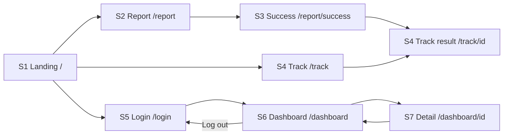
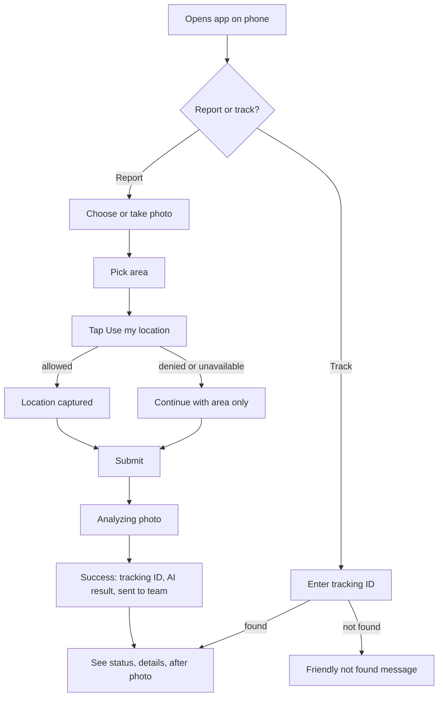
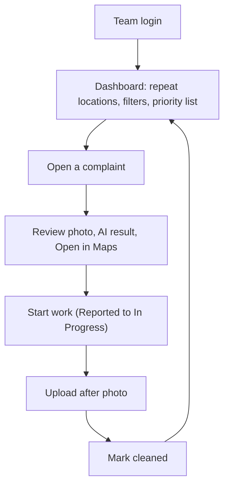

# SafaiSetu UI, User Flows and Wireframes

Version 1.0 design, Day 2. Low-fidelity, mobile-first (design at 360 px width, then let it grow on desktop). Colours and tokens are in the Blueprint context pack (A4). Every screen below exists for a stated reason; nothing else is built in v1.

---

## 1. Design principles

- **One job per screen.** Residents report or track. Teams review and update.
- **Phone first.** Large tap targets (at least 44 px), single column, no hover-only actions.
- **Plain language.** No jargon; severity and status always have a colour and a word, never colour alone.
- **Always say what happens next** (after submit, after status change).
- **Every data screen has loading, empty and error states.**

---

## 2. Screen inventory

| ID | Route | Audience | Why it exists | Requirements |
|---|---|---|---|---|
| S1 | `/` | Everyone | Entry point with the three actions | FR-18 |
| S2 | `/report` | Resident | Collect photo, area, GPS | FR-1 to FR-4 |
| S3 | `/report/success` | Resident | Show tracking ID, AI result, routing | FR-5 to FR-8 |
| S4 | `/track` and `/track/[id]` | Resident | Look up status (one screen with a search box, result below) | FR-9 |
| S5 | `/login` | Team | Sign in | FR-10 |
| S6 | `/dashboard` | Team | Priority list, filters, repeat locations | FR-11, FR-12, FR-16 |
| S7 | `/dashboard/[id]` | Team | Review one complaint and update status | FR-13 to FR-15 |
| S8 | not-found and error pages | Everyone | Friendly dead ends | FR-19 |

Eight screens. No settings, profile, map or admin screens (out of scope).

---

## 3. Navigation

- **Public header (S1 to S5):** logo (goes to `/`), `Track`, `Login`. A large `Report garbage` button appears on S1 and is the primary action everywhere else a resident could be stuck.
- **Team header (S6, S7):** logo (goes to `/dashboard`), team name, `Log out`. S7 has a `Back to list` link.
- **After login** go to `/dashboard`. **After logout** go to `/login`.
- **Guard:** `/dashboard/*` redirects to `/login` when logged out. A logged-in user visiting `/login` goes to `/dashboard`.

### Screen flow



### Resident journey



### Team journey



---

## 4. Wireframes

### S1 Landing `/`

*Reason:* one screen, three actions, explains the product in a glance.

```text
+----------------------------------------+
| SafaiSetu              Track | Login   |
+----------------------------------------+
|                                        |
| Report garbage.                        |
| Get it cleaned.                        |
| Track every step.                      |
|                                        |
|          [ Report garbage ]            |
|        [ Track a complaint ]           |
|                                        |
| How it works                           |
| 1 Photo   2 AI check   3 Cleaned       |
+----------------------------------------+
| Demo project, fictional areas          |
+----------------------------------------+
```

- Primary button is full width and filled; secondary is outlined.
- Footer line makes clear the areas are demo data.

### S2 Report `/report`

*Reason:* the whole resident flow in one short form (photo, area, GPS).

```text
+----------------------------------------+
| SafaiSetu              Track | Login   |
+----------------------------------------+
| Report garbage                         |
|                                        |
| 1. Photo                               |
| +------------------------------+       |
| |   [ Take or choose photo ]   |       |
| |        (preview here)        |       |
| +------------------------------+       |
| 2. Area                                |
| [ Select your area            v ]      |
|                                        |
| 3. Location                            |
| [ Use my location ]                    |
| Location captured  (or: not shared)    |
|                                        |
| Photos are analysed by an AI           |
| service. Avoid faces and plates.       |
|                                        |
|          [ Submit report ]             |
+----------------------------------------+
```

- Submit is disabled until a photo and an area are chosen.
- While sending: button shows `Analyzing photo...` and is disabled.
- Location messages: captured, denied ("You can still submit with your area"), unavailable, timed out.
- Errors appear above the button; the photo and area stay filled so the resident can retry.

### S3 Success `/report/success?id=SS-7K3M9Q`

*Reason:* confirms receipt, shows the tracking ID, and shows what the AI concluded and who received it.

```text
+----------------------------------------+
| SafaiSetu              Track | Login   |
+----------------------------------------+
| Report received                        |
|                                        |
| Your tracking ID                       |
| SS-7K3M9Q    [ Copy ]                  |
|                                        |
| Waste type : Mixed                     |
| Severity   : [ HIGH ]                  |
| Large heap spilling onto the road.     |
|                                        |
| Sent to: Municipal Sanitation Team     |
| Area: Ward 7 - Old Town                |
|                                        |
|       [ Track this complaint ]         |
|          [ Report another ]            |
+----------------------------------------+
```

- If the AI failed: show `Needs manual review` instead of waste type and severity, in neutral colour.
- Invalid or missing id: show the not-found state with a link to Track.

### S4 Track `/track` and `/track/[id]`

*Reason:* residents check progress without an account. One screen: search box on top, result below.

```text
+----------------------------------------+
| SafaiSetu              Track | Login   |
+----------------------------------------+
| Track a complaint                      |
| [ SS-7K3M9Q            ] [Find]        |
+----------------------------------------+
| Status                                 |
| (1)Reported-(2)In Progress-(3)Cleaned  |
| Now: In Progress                       |
|                                        |
| Area: Ward 7 - Old Town                |
| Team: Municipal Sanitation Team        |
| Mixed waste, severity HIGH             |
| Reported 2 days ago                    |
|                                        |
| Before                                 |
| [ photo ]                              |
| After (when cleaned)                   |
| [ photo ]                              |
+----------------------------------------+
```

- Input is trimmed and uppercased.
- Not found: `We could not find that ID. Check it and try again.`
- Exact GPS is never shown.

### S5 Login `/login`

*Reason:* the only way into the team area. No sign-up link.

```text
+----------------------------------------+
| SafaiSetu              Track | Login   |
+----------------------------------------+
| Team login                             |
|                                        |
| Email                                  |
| [                              ]       |
| Password                               |
| [                              ]       |
|                                        |
|              [ Log in ]                |
|                                        |
| Wrong details? Check email and         |
| password and try again.                |
+----------------------------------------+
```

- Generic error message for any failure (does not say which field was wrong).
- Button disabled while signing in.

### S6 Dashboard `/dashboard`

*Reason:* the team's working screen: what to clean first, status filter, repeat spots.

```text
+----------------------------------------+
| SafaiSetu   Municipal Team  [Log out]  |
+----------------------------------------+
| Top repeat locations                   |
| 1. Ward 7 - Old Town, 4 reports  [map] |
| 2. Ward 12 - Market Road, 3   [map]    |
+----------------------------------------+
| [All] [Reported] [In Progress] [Cleane |
|                                        |
| +------------------------------+       |
| |[img] HIGH  Mixed             |       |
| |      Ward 7 - Old Town       |       |
| |      2 days ago  Reported    |       |
| +------------------------------+       |
| +------------------------------+       |
| |[img] MED   Plastic           |       |
| |      Ward 12 - Market Road   |       |
| |      1 day ago  In Progress  |       |
| +------------------------------+       |
+----------------------------------------+
```

- List order follows the priority rule (open first, severity high to low, oldest first).
- Filter tabs use a URL parameter so refresh keeps the filter.
- Repeat panel shows `No repeat spots yet` when empty. `[map]` is a plain link that opens the location in a maps website (no embedded map in v1).
- Whole card is tappable.

### S7 Complaint detail `/dashboard/[id]`

*Reason:* review evidence and update status with proof.

```text
+----------------------------------------+
| < Back to list           [Log out]     |
+----------------------------------------+
| SS-7K3M9Q        Status: Reported      |
| +------------------------------+       |
| |        [ report photo ]      |       |
| +------------------------------+       |
| Mixed waste     Severity [ HIGH ]      |
| AI: Large heap spilling onto road.     |
| Area: Ward 7 - Old Town                |
| Location: [ Open in Maps ]             |
| Reported 2 days ago                    |
+----------------------------------------+
| Next step                              |
| [Start work ]                          |
|                                        |
| After starting: choose after photo     |
| [ Choose photo ]  (preview)            |
|           [ Mark cleaned ]             |
+----------------------------------------+
```

- Only the next valid action is shown: `Start work` when Reported, `Mark cleaned` when In Progress, nothing when Cleaned (shows the after photo instead).
- `Mark cleaned` stays disabled until an after photo is chosen.
- Buttons disable while saving; success or error message appears inline.
- `Open in Maps` hidden when the complaint has no GPS.

### S8 Not found and error

*Reason:* no dead ends (unknown URL, unexpected error).

```text
+----------------------------------------+
| SafaiSetu              Track | Login   |
+----------------------------------------+
|                                        |
| Page not found                         |
|                                        |
| The page you are looking for           |
| does not exist.                        |
|                                        |
|            [ Go to home ]              |
+----------------------------------------+
```

- The error page uses the same layout with `Something went wrong` and a `Try again` button.

---

## 5. States checklist (Day 8 uses this)

| Screen | Loading | Empty | Error |
|---|---|---|---|
| S2 | Analyzing photo (button) | n/a | Message above button, data kept |
| S3 | n/a (server rendered) | Invalid id state | Friendly error page |
| S4 | Skeleton under search | Prompt to enter an ID | Not found message |
| S6 | Skeleton cards | `No complaints in this view` | Retry message |
| S7 | Skeleton | n/a | Inline action errors |

## 6. Shared components (built once, reused)

`SiteHeader`, `TeamHeader`, `Button`, `Card`, `SeverityBadge` (green, amber, red), `StatusBadge`, `StatusStepper`, `Alert`, `Skeleton`, `PhotoPicker` (used for report and after photos), `ComplaintCard`, `FilterTabs`, `RepeatLocationsPanel`.

## 7. Accessibility basics

Every input has a visible label; images have alt text (for example `Photo of garbage reported in Ward 7`); severity and status use text plus colour; focus outlines stay visible; buttons are real `button` elements.

## 8. Key microcopy

| Place | Text |
|---|---|
| Report submit | `Submit report` / `Analyzing photo...` |
| GPS denied | `Location not shared. You can still submit with your area.` |
| AI failed | `Needs manual review` |
| Track not found | `We could not find that ID. Check it and try again.` |
| Photo notice | `Photos are analysed by an AI service. Please avoid faces and number plates.` |
| Login error | `Wrong details? Check your email and password and try again.` |
